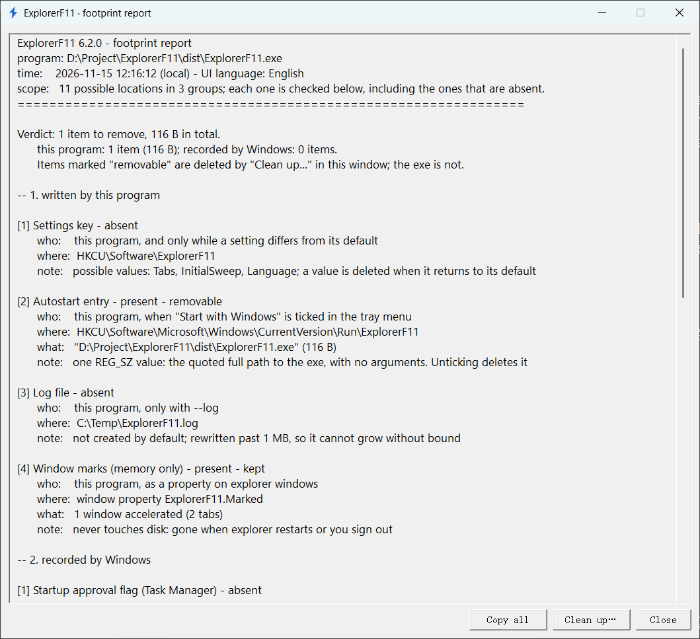

# ExplorerF11

**Makes Windows 11 File Explorer feel fast again — automatically, event-driven,
zero footprint by default.**

Windows 11's Explorer builds its command bar, address bar and navigation pane out
of XAML. Every navigation re-synchronises that chrome. Pressing `F11` twice
(fullscreen and back) throws the chrome away and rebuilds it, and the rebuilt
window navigates noticeably faster. That trick is well known and entirely manual.

ExplorerF11 automates it: when a folder window appears, or you open a new tab in
one, it posts the same two F11 cycles to that window. Acceleration is counted per
window - every tab in a window is covered by the same round trip, and no tab is
ever accelerated on its own. No polling, no focus stealing, no administrator
rights, one 333 KB exe.

> **This is not a bug fix.** It automates a workaround for undocumented shell
> behaviour. Microsoft has never shipped a patch that targets this difference;
> see [docs/RESEARCH.md](docs/RESEARCH.md) for the evidence and the timeline.

<p align="center">
  
  
</p>

<p align="center"><sub>The UI in English; <a href="README.zh-CN.md">README.zh-CN.md</a>
shows the same screens in Chinese.</sub></p>

## Why another one

Every existing tool in this niche is either an AutoHotkey script that polls every
300 ms, or a one-shot launcher that only handles the window it was started for.
This one was written to answer three questions properly:

1. **Does it cost anything when idle?** One idle thread, ~3.5 MB private, 148
   handles, zero CPU — it sleeps in `GetMessage` until the shell reports a window.
2. **Does it break Explorer?** It only posts messages, never injects, never
   hooks a DLL, never patches memory. A failed message pair is rolled back by
   exiting fullscreen and dropping the window's mark.
3. **What does it leave behind?** By default: nothing. No registry key, no file.
   When you do change something, the tool shows you exactly what it wrote, and
   one command removes all of it, including the records Windows itself makes.

## Requirements

- Windows 11 (x64). Tested on 26300.9974.
- Nothing else. No .NET, no VC++ runtime, no AutoHotkey.
- Administrator rights are **not** required for normal use. Only deleting
  Prefetch entries needs elevation, and `--clean` simply reports what it skipped.

## Quick start

1. Put `ExplorerF11.exe` somewhere permanent (it writes no files, so any folder
   works; `%LOCALAPPDATA%\Programs\ExplorerF11\` is a good default).
2. Run it. A tray icon appears; open a new folder window and it is already
   accelerated.
3. Optional: tray → **Start with Windows**.

That is the whole setup. There is no installer and no service.

The UI is Chinese or English, switchable at run time under tray → **Language**.
See [Language](#language) for the exact resolution order.

## Language

Both translations live in the binary; there is no resource DLL. The menu row
`Language` / 界面语言 holds a radio pair — 中文（简体） and English — each written
in its own script, so the menu stays usable even after switching to a language
you do not read. A switch is immediate: the menu, the tray tooltip and an open
footprint window all follow, and the choice is remembered.

Resolution order, highest priority first:

| Source | Scope |
|---|---|
| `--lang zh\|en` | this run only |
| `EXPLORERF11_LANG=zh\|en` | this run only (scripts, portable copies) |
| the tray choice, stored as `HKCU\Software\ExplorerF11\Language` | persistent |
| the Windows display language | default |

The stored value obeys the same zero-trace rule as every other setting: it
exists only while it differs from the system language, and picking the system
language again deletes it. A user who never opens that submenu writes nothing.

## Command line

```
ExplorerF11.exe [options]

  (none)            run in the tray, accelerate folder windows opened later
  --install         run in the tray and tick "Start with Windows"
  --uninstall       remove the autostart entry only, nothing else
  --status          print the full footprint report; exit 0 = clean, 1 = traces
  --clean, --purge  remove every removable trace, then exit (closes a running copy)
  --menu            print the tray menu as text (tests and troubleshooting)
  --lang zh|en      UI language for this run
  --log             write %TEMP%\ExplorerF11.log
  --no-initial      leave windows that were already open alone
  --quiet           never show a message box (for scripts)
  --version, -v     print the version
  --help, -h        print this help
```

`--status` is scriptable:

```powershell
ExplorerF11.exe --status --lang en
if ($LASTEXITCODE -eq 0) { "clean" } else { "traces present" }
```

## Footprint

Zero by default. The report lists 11 possible locations in three groups, with who
writes each one, where it is, what it currently holds and whether cleanup
removes it — see [docs/FOOTPRINTS.md](docs/FOOTPRINTS.md).

| Group | Examples | Removable |
|---|---|---|
| Written by this program | settings key (`Tabs`, `InitialSweep`, `Language`), autostart value, log file | `--clean` |
| Recorded by Windows | tray icon cache, StartupApproved, Compatibility Assistant, MuiCache, UserAssist, Prefetch | `--clean` |
| Program file | the exe itself | delete it = uninstall |

Worst case, everything removable is under 6 KB. Nothing grows over time: no
history, no cache, no log by default.

## Build

```bat
build.bat            :: MSVC if available, else MinGW-w64
build.bat debug
```

or with MinGW make:

```sh
make
make test
```

Both produce a single self-contained `dist\ExplorerF11.exe`. Sources are plain
C++17 + Win32; the only libraries are `user32`, `shell32`, `advapi32`.

## Tests

The suite drives the built binary, not a mock: menu layout including the
language submenu, footprint report in both languages, registry policy, language
switching end to end, tray-cleanup selectivity, and a smoke test that checks the
process profile. Every suite asserts and exits non-zero on failure.

```bat
python tests\test_menu_order.py
python tests\test_footprint_report.py
python tests\test_registry_policy.py
python tests\test_language.py
python tests\test_tray_cleanup.py
python tests\test_smoke.py
```

Tests restore the state they found, including the autostart entry and the
stored language. The one destructive step (the clean button) only runs when the
machine is already clean.

## Documentation

| | |
|---|---|
| [docs/USAGE.en.md](docs/USAGE.en.md) · [中文](docs/USAGE.zh-CN.md) | every option, menu item and dialog explained |
| [docs/ARCHITECTURE.md](docs/ARCHITECTURE.md) | modules, event model, why no polling, resource profile |
| [docs/FOOTPRINTS.md](docs/FOOTPRINTS.md) | all 11 locations, who writes them, how to verify by hand |
| [docs/RESEARCH.md](docs/RESEARCH.md) | the F11 behaviour, Microsoft's patch history, every existing tool |

## License

MIT. See [LICENSE](LICENSE).

Windows and File Explorer are trademarks of Microsoft Corporation. This project
is not affiliated with or endorsed by Microsoft.
