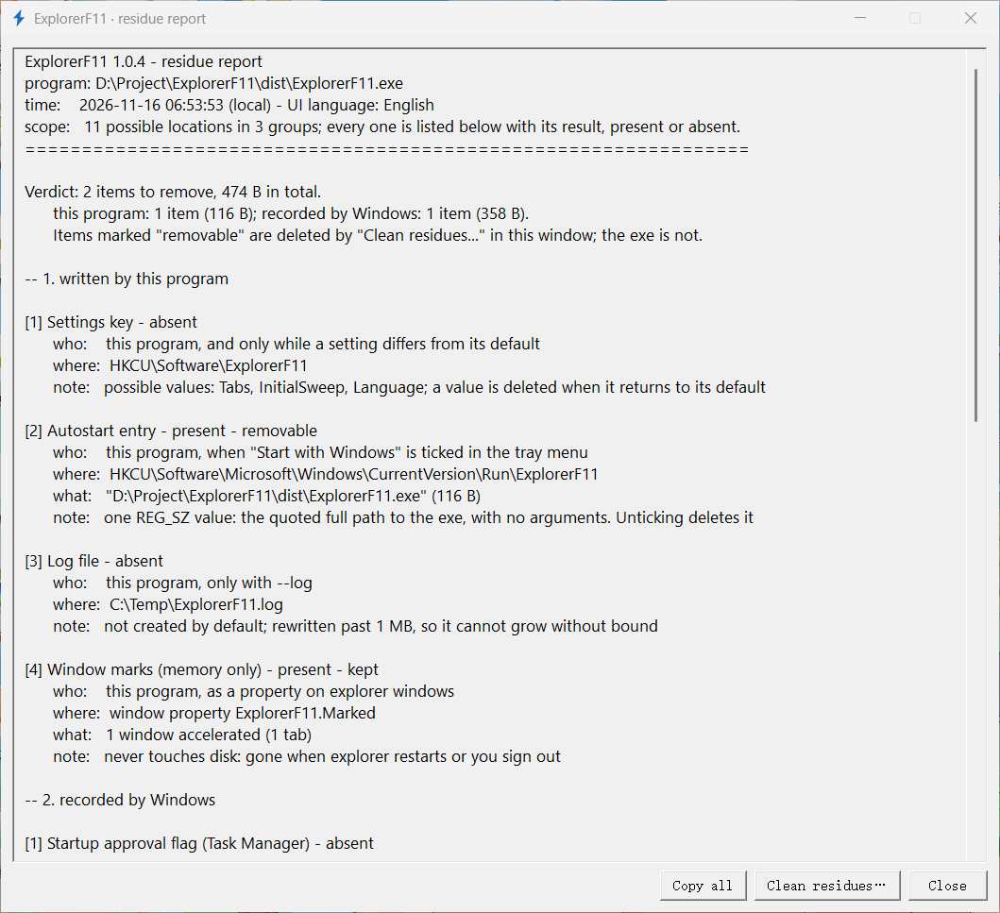

# ExplorerF11

<p align="center">
  
</p>

[](https://github.com/QzCrane/ExplorerF11/actions/workflows/build.yml)
[](https://github.com/QzCrane/ExplorerF11/releases/latest)
[](LICENSE)


A tray utility that sends an F11 round trip to newly opened Windows 11 Explorer
windows. Event-driven, one unsigned 411 KiB executable, no registry writes under
the default configuration. [中文说明](README.zh-CN.md).

<p align="center">
  
  
</p>

## The mechanism

Explorer draws its command bar, address bar and navigation pane in XAML and
re-synchronises them on every navigation. Pressing `F11` twice destroys that
chrome and rebuilds it; the rebuilt window navigates faster, particularly in
folders with shell extensions. ExplorerF11 does the same two key presses for you,
using `PostMessageW` directly to the target window's queue.

Four details define what the tool is:

- **No polling.** A shell hook reports top-level window creation; a WinEvent hook
  reports tab creation and restore-from-minimised. Idle time is spent blocked in
  `GetMessageW`: 1.77 MB private, 129 handles, 0.03 s cumulative CPU over two
  minutes on the test machine.
- **No injection, no focus theft.** `PostMessageW` delivers key messages without
  touching the foreground window or the real keyboard state. There is no DLL
  injection, no memory patching and no `SendInput`.
- **One action per window.** `F11` is handled by the `CabinetWClass` frame, so one
  round trip covers every tab in that window. Tabs (`ShellTabWindowClass`) have no
  F11 state of their own. The status line reads `1 window accelerated (2 tabs)` —
  windows are the unit of work, the bracket is what those windows currently hold.
- **Nothing to uninstall beyond the file.** Settings are stored as deviations
  from defaults, so a default run writes no registry value and creates no file.
  `--status` enumerates all 11 possible residue locations with live values;
  `--clean` removes every removable one.

This is a workaround for undocumented shell behaviour, not a fix. Microsoft has
not shipped an update that targets the underlying difference. The measurements,
the update history and the rejected alternatives are in
[docs/RESEARCH.md](docs/RESEARCH.md).

## Install and first run

Download `ExplorerF11-1.0.4-win64.exe` from the
[latest release](https://github.com/QzCrane/ExplorerF11/releases/latest), check
its hash, and put it anywhere permanent — it writes no files, so any folder
works. `%LOCALAPPDATA%\Programs\ExplorerF11\` is a reasonable choice.

```powershell
Get-FileHash .\ExplorerF11-1.0.4-win64.exe -Algorithm SHA256
```

The binary is **not code-signed**; SmartScreen will warn on first run. Compare
the hash with the one on the release page before continuing.
[docs/SIGNING.md](docs/SIGNING.md) records why, what a certificate would and
would not change, and what it costs. Double-click the
exe, open a folder window, and the tray tooltip will report the acceleration.
Tray → *Start with Windows* adds one `HKCU\...\Run\ExplorerF11` value with the
quoted executable path and no arguments.

Requirements: Windows 11 x64 (verified on build 26300.9974), no .NET, no VC++
runtime, no administrator rights. Deleting Prefetch entries is the only
operation that needs elevation; `--clean` reports what it could not remove.

## Language

Five translations are compiled into the exe; there are no satellite DLLs. Tray →
*Language* is a five-way radio group. Every row is written in its own language,
in a fixed order, so a mis-click does not leave you with an unreadable menu.
The report header prints the same endonym after `UI language:`.

| Menu label | Accepted tags |
|---|---|
| 简体中文 | `zh`, `zh-cn`, `zh-hans`, `zh-sg` |
| 繁體中文 | `zh-Hant`, `zh-tw`, `zh-hk`, `zh-mo` |
| English | `en`, `en-us`, `en-gb` |
| 日本語 | `ja`, `ja-jp` |
| 한국어 | `ko`, `ko-kr` |

Resolution order, highest priority first:

| Source | Scope |
|---|---|
| `--lang <tag>` | this run |
| `EXPLORERF11_LANG=<tag>` | this run — scripts and portable copies |
| the tray choice, stored at `HKCU\Software\ExplorerF11\Language` | persistent |
| Windows regional format, then UI language | default |

The stored value follows the same rule as every setting: it exists only while it
differs from the system language, and selecting the system language again deletes
it. Switching at run time repaints the tray menu, the tooltip and any open report
window immediately.

## Command line

```
ExplorerF11.exe [options]

  (none)            run in the tray, accelerate folder windows opened later
  --install         run in the tray and tick "Start with Windows"
  --uninstall       remove the autostart entry only, nothing else
  --status          print the residue report; exit 0 = clean, 1 = residues
  --clean, --purge  remove every removable residue, then exit (stops a running copy)
  --menu            print the tray menu as text (tests and troubleshooting)
  --lang <tag>      UI language for this run (zh/zh-Hant/en/ja/ko)
  --log             write %TEMP%\ExplorerF11.log
  --no-initial      leave windows that were already open alone
  --quiet           suppress message boxes (for scripts)
  --version, -v     print the version
  --help, -h        print this help
```

```powershell
ExplorerF11.exe --status --lang en
if ($LASTEXITCODE -eq 0) { "clean" } else { "residues present" }
```

Exit codes: `0` success or a clean machine, `1` residues found by `--status`,
`2` usage error. Unknown options are echoed back with a pointer to `--help` — a
typo never starts a tray instance that appears to have done something. A bare
`--lang`, or one followed by another option, reports a missing language tag
rather than consuming that option as a value.

## Residue

All 11 locations, who writes each of them and how to verify them by hand are in
[docs/RESIDUE.md](docs/RESIDUE.md). In summary:

| Group | Examples | Removal |
|---|---|---|
| Written by this program | settings values, autostart, log, window property | `--clean`; the property goes away with Explorer |
| Recorded by Windows | tray icon cache, StartupApproved, Compatibility Assistant, MuiCache, UserAssist, Prefetch | `--clean` (Prefetch needs elevation) |
| The executable itself | the file you downloaded | delete it after `--clean` |

Worst case, everything removable is under 6 KB excluding Prefetch, which is a
Windows-managed cache. Nothing accumulates with use: no history, no database, no
log unless `--log` is passed.

## Build and verify

```bat
build.bat            :: MSVC if available, otherwise MinGW-w64
build.bat debug
```

or, with MinGW-w64 on PATH:

```sh
make
make test
```

Plain C++23 and Win32; the only imported libraries are `user32`, `shell32` and
`advapi32`. `make test` runs 13 gates — four static checks over sources and
translations, nine suites that drive the built binary rather than a mock — for
369 assertions. Smoke tests open a real folder window and need a desktop session.
One gate (`tests/test_robustness.py`) pins the event-driven and CLI fixes that a
CI runner cannot exercise: shell-hook recovery, F11 recovery with handle reuse,
console handle ownership, icon ownership and argument parsing.

| Documentation | Scope |
|---|---|
| [docs/USAGE.en.md](docs/USAGE.en.md) · [中文](docs/USAGE.zh-CN.md) | every option, menu item, dialog and failure mode |
| [docs/ARCHITECTURE.md](docs/ARCHITECTURE.md) | module boundaries, event model, Win32 details, resource profile |
| [docs/RESIDUE.md](docs/RESIDUE.md) | the 11 locations, write policy, manual verification |
| [docs/PERFORMANCE.md](docs/PERFORMANCE.md) | every behaviour's cost, the optimisations, and the ones rejected with reasons |
| [docs/RESEARCH.md](docs/RESEARCH.md) | measurements, update history, competing tools, rejected approaches |
| [docs/RELEASING.md](docs/RELEASING.md) | version bumps, gates, artefact build and publication |
| [SECURITY.md](SECURITY.md) | privilege use, attack surface, binary verification |
| [CONTRIBUTING.md](CONTRIBUTING.md) | invariants, code conventions, translation workflow |

## License

MIT. See [LICENSE](LICENSE).

Windows and File Explorer are trademarks of Microsoft Corporation. This project
is not affiliated with or endorsed by Microsoft.
