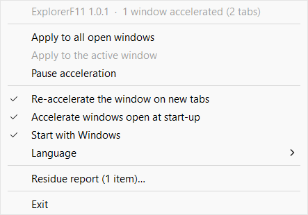

# ExplorerF11

[](https://github.com/QzCrane/ExplorerF11/actions/workflows/build.yml)
[](https://github.com/QzCrane/ExplorerF11/releases/latest)
[](LICENSE)


**An automated F11 accelerator: event-driven, and it writes nothing to the
registry by default.**

Windows 11's Explorer builds its command bar, address bar and navigation pane out
of XAML. Every navigation re-synchronises that chrome. Pressing `F11` twice
(fullscreen and back) throws the chrome away and rebuilds it, and the rebuilt
window navigates noticeably faster. That trick is well known and entirely manual.

ExplorerF11 automates it: when a folder window appears, or you open a new tab in
one, it posts the same two F11 cycles to that window. Acceleration is counted per
window - every tab in a window is covered by the same round trip, and no tab is
ever accelerated on its own. No polling, no focus stealing, no administrator
rights, one 366 KiB exe.

> **This is not a bug fix.** It automates a workaround for undocumented shell
> behaviour. Microsoft has never shipped a patch that targets this difference;
> see [docs/RESEARCH.md](docs/RESEARCH.md) for the evidence and the timeline.

<p align="center">
  
  
</p>

<p align="center"><sub>The UI in English; <a href="README.zh-CN.md">README.zh-CN.md</a>
shows the same screens in Chinese.</sub></p>

## Why another one

Every existing tool in this niche is either an AutoHotkey script that polls every
300 ms, or a one-shot launcher that only handles the window it was started for.
This one was written to answer three questions properly:

1. **Does it cost anything when idle?** One idle thread, 2.3 MB private, 156
   handles, 0 % CPU — it sleeps in `GetMessage` until the shell reports a window.
2. **Does it break Explorer?** It only posts messages, never injects, never
   hooks a DLL, never patches memory. A failed message pair is rolled back by
   exiting fullscreen and dropping the window's mark.
3. **What does it leave behind?** By default: nothing. No registry key, no file.
   When you do change something, the tool shows you exactly what it wrote, and
   one command removes all of it, including the records Windows itself makes.

## Download

[**Latest release**](https://github.com/QzCrane/ExplorerF11/releases/latest) —
`ExplorerF11-1.0.1-win64.exe`, 366 KiB, x64.

- Single file. No installer, no runtime, no service, no admin rights.
- The binary is **not code-signed**, so SmartScreen warns on first run. Verify
  the SHA-256 listed on the release page before you run it:

  ```powershell
  Get-FileHash .\ExplorerF11-1.0.1-win64.exe -Algorithm SHA256
  ```

- Every release is built from the tagged commit, and the release notes record
  the toolchain, the SHA-256 and the Windows build it was verified on. CI builds
  the same commit with MSVC on every push and on the tag.

## Requirements

- Windows 11 (x64). Tested on 26300.9974.
- Nothing else. No .NET, no VC++ runtime, no AutoHotkey.
- Administrator rights are **not** required for normal use. Only deleting
  Prefetch entries needs elevation, and `--clean` simply reports what it skipped.

## Quick start

1. Put `ExplorerF11.exe` somewhere permanent (it writes no files, so any folder
   works; `%LOCALAPPDATA%\Programs\ExplorerF11\` is a good default).
2. Run it. A tray icon appears; open a new folder window and it is already
   accelerated.
3. Optional: tray → **Start with Windows**.

That is the whole setup. There is no installer and no service.

The UI ships in Simplified Chinese, Traditional Chinese, English, Japanese and
Korean, switchable at run time under tray → **Language**. See
[Language](#language) for the exact resolution order.

## Language

All translations are compiled into the binary; there is no resource DLL. The
`Language` menu is a five-way radio group. Each entry is written in that
language's own name and script, in the same order whatever the UI language is,
so the menu stays navigable even after switching to a language you cannot read.
The report header prints the same name after "UI language:".

| Menu label | Common BCP-47 aliases |
|---|---|
| 简体中文 | `zh`, `zh-cn`, `zh-hans`, `zh-sg` |
| 繁體中文 | `zh-Hant`, `zh-tw`, `zh-hk`, `zh-mo` |
| English | `en`, `en-us`, `en-gb` |
| 日本語 | `ja`, `ja-jp` |
| 한국어 | `ko`, `ko-kr` |

Resolution order, highest priority first:

| Source | Scope |
|---|---|
| `--lang <tag>` | this run only |
| `EXPLORERF11_LANG=<tag>` | this run only (scripts, portable copies) |
| the tray choice, stored as `HKCU\Software\ExplorerF11\Language` | persistent |
| Windows locale format and UI language | default |

The stored value follows the same write policy as every other setting: it exists
only while it differs from the system language, and picking the system language
again deletes it. A user who never opens that submenu writes nothing.

## Command line

```
ExplorerF11.exe [options]

  (none)            run in the tray, accelerate folder windows opened later
  --install         run in the tray and tick "Start with Windows"
  --uninstall       remove the autostart entry only, nothing else
  --status          print the full residue report; exit 0 = clean, 1 = residues
  --clean, --purge  remove every removable residue, then exit (closes a running copy)
  --menu            print the tray menu as text (tests and troubleshooting)
  --lang <tag>      UI language for this run (zh/zh-Hant/en/ja/ko)
  --log             write %TEMP%\ExplorerF11.log
  --no-initial      leave windows that were already open alone
  --quiet           never show a message box (for scripts)
  --version, -v     print the version
  --help, -h        print this help
```

`--status` is scriptable:

```powershell
ExplorerF11.exe --status --lang en
if ($LASTEXITCODE -eq 0) { "clean" } else { "residues present" }
```

Exit codes: `0` success or a clean machine, `1` residues found by `--status`,
`2` usage error (an unknown option, or a `--lang` value that names no supported
language). An unknown option is echoed back with a pointer to `--help`; it is
never ignored, so a typo cannot silently start a tray instance.

## Residue

With default settings the program leaves no configuration data on disk. The
report enumerates 11 possible locations in three groups, recording who writes
each one, where it lives, its current value and whether cleanup removes it —
see [docs/RESIDUE.md](docs/RESIDUE.md).

| Group | Examples | Removable |
|---|---|---|
| Written by this program | settings key (`Tabs`, `InitialSweep`, `Language`), autostart value, log file | `--clean` |
| Recorded by Windows | tray icon cache, StartupApproved, Compatibility Assistant, MuiCache, UserAssist, Prefetch | `--clean` |
| Program file | the exe itself | delete it = uninstall |

Worst case, everything removable is under 6 KB. Nothing grows over time: no
history, no cache, no log by default.

## Build

```bat
build.bat            :: MSVC if available, else MinGW-w64
build.bat debug
```

or with MinGW make:

```sh
make
make test
```

Both produce a single self-contained `dist\ExplorerF11.exe`. Sources are plain
C++17 + Win32; the only libraries are `user32`, `shell32`, `advapi32`.

## Tests

`make test` runs eleven gates: three static checks over the sources and
translations, and eight suites that drive the built binary rather than a mock —
295 assertions in total. Every gate asserts and exits non-zero on failure.

| Gate | Checks |
|---|---|
| `tools/check_i18n.py` | every `T()` key exists in all five languages, placeholders match, the generated table is current |
| `tools/audit_i18n.py` | wrong script inside a translation, ASCII punctuation glued to CJK, mixed bracket styles, terminology drift |
| `tools/check_help_align.py` | the `--help` option column starts at the same offset in all five languages |
| `tests/test_lang_names.py` | the five language rows are byte-identical in every UI language; the report header names the active language (20) |
| `tests/test_menu_order.py` | menu structure, the five-row language radio, localised bodies, the counting unit, unknown-option handling (75) |
| `tests/test_residue_report.py` | the report's structure and wording in all five languages (71) |
| `tests/test_registry_policy.py` | nothing written by default; a value is deleted when its setting returns to default (28) |
| `tests/test_language.py` | command-line, environment and tray switching, live repaint, persistence (63) |
| `tests/test_icons.py` | both icons and the version block are in the binary (23) |
| `tests/test_tray_cleanup.py` | `--clean` removes this program's records and nothing else (7) |
| `tests/test_smoke.py` | the event path end to end on a real folder window, plus the resource ceilings (8) |

Tests restore the state they found, including the autostart entry and the
stored language. The one destructive step (the clean button) only runs when the
machine is already clean. The suites need a desktop session: `test_smoke.py`
opens and closes a real Explorer window.

## Documentation

| | |
|---|---|
| [docs/USAGE.en.md](docs/USAGE.en.md) · [中文](docs/USAGE.zh-CN.md) | every option, menu item and dialog explained |
| [docs/ARCHITECTURE.md](docs/ARCHITECTURE.md) | modules, event model, why no polling, resource profile |
| [docs/RESIDUE.md](docs/RESIDUE.md) | all 11 locations, who writes them, how to verify by hand |
| [docs/RESEARCH.md](docs/RESEARCH.md) | the F11 behaviour, Microsoft's patch history, every existing tool |
| [docs/RELEASING.md](docs/RELEASING.md) | version bumps, the eleven gates, how an artefact is built, verified and published |
| [SECURITY.md](SECURITY.md) | what the program does with your privileges, what it never does, how to verify a download |
| [CONTRIBUTING.md](CONTRIBUTING.md) | the three invariants, code style, the translation workflow |

## License

MIT. See [LICENSE](LICENSE).

Windows and File Explorer are trademarks of Microsoft Corporation. This project
is not affiliated with or endorsed by Microsoft.
