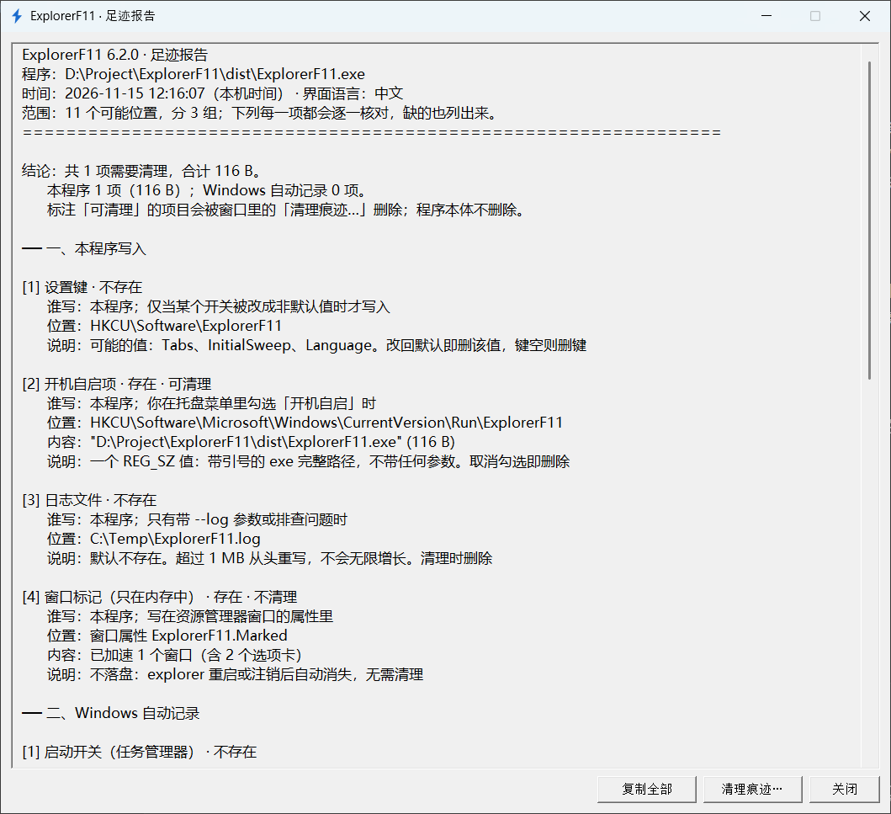

# ExplorerF11

**让 Windows 11 资源管理器重新变快——自动、事件驱动、默认零足迹。**

Windows 11 的资源管理器用 XAML 画命令栏、地址栏和导航窗格，每次导航都要重新同步
这一层。按两下 `F11`（进全屏再退出）会把这一层拆掉重建，重建后的窗口翻目录明显更
快。这个技巧流传很广，但一直得手动按。

ExplorerF11 把它自动化：文件夹窗口出现、或者你在窗口里新建选项卡时，向那个窗口
投递同样两次 F11 循环。加速以窗口为单位——窗口里的所有选项卡共用这一次往返，
不会逐个选项卡加速。不轮询、不抢焦点、不要管理员权限，单文件 333 KB。

> **这不是系统修复。** 它把绕过手段自动化了。微软从未发布针对这一差异的补丁，
> 证据与时间线见 [docs/RESEARCH.md](docs/RESEARCH.md)。

<p align="center">
  
  
</p>

<p align="center"><sub>界面为中文；英文界面见 <a href="README.md">README.md</a> 的同款截图。</sub></p>

## 与同类工具的区别

同类工具要么是每 300 ms 轮询一遍窗口的 AutoHotkey 脚本，要么是只处理启动时那一
个窗口的一次性小工具。这个项目正面回答三个问题：

1. **闲着的时候花多少资源？** 1 个空闲线程、约 3.5 MB 私有内存、148 个句柄、
   0% CPU——它阻塞在 `GetMessage`，等 Shell 报告窗口。
2. **会不会搞坏资源管理器？** 只投递消息，不注入、不挂 DLL、不改内存。投递失败
   的那一对消息会被回滚（退出全屏并撤掉窗口标记）。
3. **会留下什么？** 默认什么都不留：不写注册表、不建文件。真改了设置，程序会把
   写了什么一条条列给你看，一条命令全部清掉——连 Windows 自己记的那几项也清。

## 环境要求

- Windows 11 x64（在 26300.9974 上实测）。
- 不需要任何运行库，不需要管理员权限。只有删 Prefetch 需要提权，`--clean` 会
  如实告诉你哪一项没删掉。

## 快速开始

1. 把 `ExplorerF11.exe` 放到一个固定位置（它不写文件，放哪都行；
   建议 `%LOCALAPPDATA%\Programs\ExplorerF11\`）。
2. 双击运行。托盘出现图标，之后新开的文件夹窗口自动生效。
3. 可选：托盘 → **开机自启**。

没有安装程序，没有服务，就这些。

界面语言是中文或英文，运行中随时可在托盘 → **界面语言** 里切换；优先级与保存
规则见下面的[语言](#语言)一节。

## 语言

两种文案都编在同一个 exe 里，没有资源 DLL。托盘里 `界面语言` / `Language` 是一
组单选：**中文（简体）** 与 **English**，各自用本语言书写，所以即使误切到看不懂
的语言，也能照着字形找回来。切换立即生效——菜单、托盘提示、已经打开的足迹窗口
会一起改，选择会被记住。

优先级从高到低：

| 来源 | 作用范围 |
|---|---|
| `--lang zh\|en` | 仅本次运行 |
| `EXPLORERF11_LANG=zh\|en` | 仅本次运行（脚本、便携拷贝） |
| 托盘里的选择，存为 `HKCU\Software\ExplorerF11\Language` | 长期有效 |
| Windows 显示语言 | 默认值 |

保存值遵守与其他设置相同的零足迹规则：只有与系统语言不同时才存在，选回系统语
言即删除该值并顺带删掉空键。从不打开这个子菜单的用户，一个字节都不会写。

## 命令行

```
ExplorerF11.exe [选项]

  （无参数）        在托盘里运行，自动加速之后打开的文件夹窗口
  --install         在托盘里运行，并勾选开机自启
  --uninstall       只删除开机自启项，其他一切不动
  --status          打印完整足迹报告；退出码 0=干净，1=有可清理项
  --clean, --purge  删除全部可清理痕迹后退出（会先关闭正在运行的实例）
  --menu            把托盘菜单按文本打印出来（供测试与排查）
  --lang zh|en      本次运行的界面语言
  --log             写日志到 %TEMP%\ExplorerF11.log
  --no-initial      不处理启动前已经打开的窗口
  --quiet           不弹任何对话框（脚本用）
  --version, -v     打印版本号
  --help, -h        打印这段说明
```

## 足迹

默认零写入。报告列出 11 个可能的位置、分三组，每条都写明谁写的、在哪、现在有
什么、清理时删不删，详见 [docs/FOOTPRINTS.md](docs/FOOTPRINTS.md)。

| 分组 | 例子 | 怎么清 |
|---|---|---|
| 本程序写入 | 设置键（`Tabs`、`InitialSweep`、`Language`）、自启项、日志文件 | `--clean` |
| Windows 自动记录 | 托盘图标缓存、启动开关、兼容性助手、MuiCache、UserAssist、Prefetch | `--clean` |
| 程序本体 | exe 自己 | 删掉它 = 卸载 |

最坏情况全部加起来不到 6 KB，而且不会越用越多：没有历史记录、没有缓存、默认不写
日志。

## 编译

```bat
build.bat            :: 有 MSVC 就用 MSVC，否则用 MinGW-w64
build.bat debug
```

或者 MinGW make：

```sh
make
make test
```

产出单个自包含的 `dist\ExplorerF11.exe`。纯 C++17 + Win32，只依赖 `user32`、
`shell32`、`advapi32`。

## 测试

测试直接驱动编译出来的 exe，不用 mock：菜单顺序（含语言子菜单）、双语足迹报告、
注册表策略、语言切换全流程、托盘记录的精确清理，以及一个检查进程画像的冒烟测试。
每个套件都会断言并在失败时返回非零。

```bat
python tests\test_menu_order.py
python tests\test_footprint_report.py
python tests\test_registry_policy.py
python tests\test_language.py
python tests\test_tray_cleanup.py
python tests\test_smoke.py
```

测试会把改动过的状态还原，包括自启项和保存的语言。唯一的破坏性步骤（清理按钮）
只在机器本来就干净时执行。

## 文档

| | |
|---|---|
| [docs/USAGE.zh-CN.md](docs/USAGE.zh-CN.md) · [English](docs/USAGE.en.md) | 每个选项、每个菜单项、每个对话框 |
| [docs/ARCHITECTURE.md](docs/ARCHITECTURE.md) | 模块划分、事件模型、为什么不用轮询、资源占用 |
| [docs/FOOTPRINTS.md](docs/FOOTPRINTS.md) | 11 个位置、谁写的、怎么手动核对 |
| [docs/RESEARCH.md](docs/RESEARCH.md) | F11 行为、微软补丁史、所有同类工具 |

## 许可

MIT，见 [LICENSE](LICENSE)。

Windows 与文件资源管理器是微软公司的商标。本项目与微软无关，也未获其背书。
