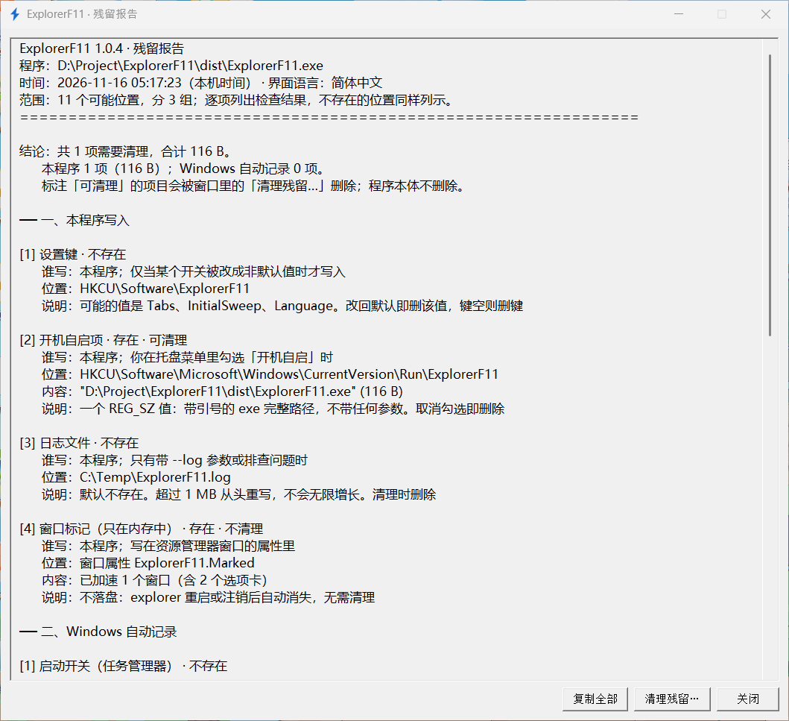

# ExplorerF11

[](https://github.com/QzCrane/ExplorerF11/actions/workflows/build.yml)
[](https://github.com/QzCrane/ExplorerF11/releases/latest)
[](LICENSE)


**自动化的 F11 加速工具：事件驱动，默认不写入注册表。**

Windows 11 的资源管理器用 XAML 画命令栏、地址栏和导航窗格，每次导航都要重新同步
这一层。按两下 `F11`（进全屏再退出）会把这一层拆掉重建，重建后的窗口翻目录明显更
快。这个技巧流传很广，但一直得手动按。

ExplorerF11 把它自动化：文件夹窗口出现、或者你在窗口里新建选项卡时，向那个窗口
投递同样两次 F11 循环。加速以窗口为单位——窗口里的所有选项卡共用这一次往返，
不会逐个选项卡加速。不轮询、不抢焦点、不要管理员权限，单文件 366 KiB。

> **这不是系统修复。** 它把绕过手段自动化了。微软从未发布针对这一差异的补丁，
> 证据与时间线见 [docs/RESEARCH.md](docs/RESEARCH.md)。

<p align="center">
  
  
</p>

<p align="center"><sub>界面为中文；英文界面见 <a href="README.md">README.md</a> 的同款截图。</sub></p>

## 与同类工具的区别

同类工具要么是每 300 ms 轮询一遍窗口的 AutoHotkey 脚本，要么是只处理启动时那一
个窗口的一次性小工具。这个项目正面回答三个问题：

1. **闲着的时候花多少资源？** 1 个空闲线程、2.3 MB 私有内存、156 个句柄、
   0% CPU——它阻塞在 `GetMessage`，等 Shell 报告窗口。
2. **会不会搞坏资源管理器？** 只投递消息，不注入、不挂 DLL、不改内存。投递失败
   的那一对消息会被回滚（退出全屏并撤掉窗口标记）。
3. **会留下什么？** 默认什么都不留：不写注册表、不建文件。真改了设置，程序会把
   写了什么一条条列给你看，一条命令全部清掉——连 Windows 自己记的那几项也清。

## 下载

[**最新发行版**](https://github.com/QzCrane/ExplorerF11/releases/latest)——
`ExplorerF11-1.0.0-win64.exe`，366 KiB，x64。

- 单文件。没有安装程序、没有运行库、没有服务，不需要管理员权限。
- 二进制**未做代码签名**，首次运行会触发 SmartScreen 警告。运行前请核对发行页
  上列出的 SHA-256：

  ```powershell
  Get-FileHash .\ExplorerF11-1.0.0-win64.exe -Algorithm SHA256
  ```

- 每个发行版都从对应 tag 构建，发行说明里写明所用的工具链、SHA-256 与实测的
  Windows 版本。CI 在每次推送和打 tag 时用 MSVC 构建同一个提交。

## 环境要求

- Windows 11 x64（在 26300.9974 上实测）。
- 不需要任何运行库，不需要管理员权限。只有删 Prefetch 需要提权，`--clean` 会
  如实告诉你哪一项没删掉。

## 快速开始

1. 把 `ExplorerF11.exe` 放到一个固定位置（它不写文件，放哪都行；
   建议 `%LOCALAPPDATA%\Programs\ExplorerF11\`）。
2. 双击运行。托盘出现图标，之后新开的文件夹窗口自动生效。
3. 可选：托盘 → **开机自启**。

没有安装程序，没有服务，就这些。

界面提供简体中文、繁体中文、英文、日文和韩文五种文案，运行中随时可在托盘 →
**界面语言** 里切换；优先级与保存规则见下面的[语言](#语言)一节。

## 语言

所有文案都编在同一个 exe 里，没有资源 DLL。托盘的 `界面语言` 是一组单选：五项
各用该语言的自称书写，顺序在任何界面语言下都相同，因此即使误切到不熟悉的语言，
也能按字形找回。报告头里的「界面语言：」后面写的就是同一个名字。

| 菜单标签 | 常用 BCP-47 别名 |
|---|---|
| 简体中文 | `zh`、`zh-cn`、`zh-hans`、`zh-sg` |
| 繁體中文 | `zh-Hant`、`zh-tw`、`zh-hk`、`zh-mo` |
| English | `en`、`en-us`、`en-gb` |
| 日本語 | `ja`、`ja-jp` |
| 한국어 | `ko`、`ko-kr` |

切换立即生效：托盘菜单、状态与悬浮提示、已经打开的残留报告窗口（标题、正文和按钮）
会一起更新，选择会被记住。

优先级从高到低：

| 来源 | 作用范围 |
|---|---|
| `--lang <tag>` | 仅本次运行 |
| `EXPLORERF11_LANG=<tag>` | 仅本次运行（脚本、便携拷贝） |
| 托盘里的选择，存为 `HKCU\Software\ExplorerF11\Language` | 长期有效 |
| Windows 区域格式与 UI 语言 | 默认值 |

保存值遵守与其他设置相同的规则：只有与系统语言不同时才存在，选回系统语
言即删除该值并顺带删掉空键。从不打开这个子菜单的用户，一个字节都不会写。

## 命令行

```
ExplorerF11.exe [选项]

  （无参数）        在托盘里运行，自动加速之后打开的文件夹窗口
  --install         在托盘里运行，并勾选开机自启
  --uninstall       只删除开机自启项，其他一切不动
  --status          打印完整残留报告；退出码 0=干净，1=有可清理项
  --clean, --purge  删除全部可清理残留后退出（会先关闭正在运行的实例）
  --menu            把托盘菜单按文本打印出来（供测试与排查）
  --lang <tag>      本次运行的界面语言（zh/zh-Hant/en/ja/ko）
  --log             写日志到 %TEMP%\ExplorerF11.log
  --no-initial      不处理启动前已经打开的窗口
  --quiet           不弹任何对话框（脚本用）
  --version, -v     打印版本号
  --help, -h        打印这段说明
```

退出码：`0` 成功或机器干净，`1` 是 `--status` 找到可清理残留，`2` 是用法错误
（未知选项，或 `--lang` 给了不支持的语言标签）。未知选项会被原样打印并提示
`--help`，不会被忽略——打字错误不会静默启动一个托盘实例。

## 残留

默认配置不写入注册表。报告列出 11 个可能的位置、分三组，每条都写明谁写的、在哪、现在有
什么、清理时删不删，详见 [docs/RESIDUE.md](docs/RESIDUE.md)。

| 分组 | 例子 | 怎么清 |
|---|---|---|
| 本程序写入 | 设置键（`Tabs`、`InitialSweep`、`Language`）、自启项、日志文件 | `--clean` |
| Windows 自动记录 | 托盘图标缓存、启动开关、兼容性助手、MuiCache、UserAssist、Prefetch | `--clean` |
| 程序本体 | exe 自己 | 删掉它 = 卸载 |

最坏情况全部加起来不到 6 KB，而且不会越用越多：没有历史记录、没有缓存、默认不写
日志。

## 编译

```bat
build.bat            :: 有 MSVC 就用 MSVC，否则用 MinGW-w64
build.bat debug
```

或者 MinGW make：

```sh
make
make test
```

产出单个自包含的 `dist\ExplorerF11.exe`。纯 C++17 + Win32，只依赖 `user32`、
`shell32`、`advapi32`。

## 测试

`make test` 跑 11 道闸门：3 项针对源码与译文的静态检查，8 个直接驱动编译产物
的套件（不用 mock），合计 295 项断言。每道闸门都会断言，失败即返回非零。

| 闸门 | 检查内容 |
|---|---|
| `tools/check_i18n.py` | 每个 `T()` 键在五种语言里都存在、占位符一致、生成的表是最新的 |
| `tools/audit_i18n.py` | 译文里混入错误书写系统、ASCII 标点贴 CJK、括号半全角混用、术语漂移 |
| `tools/check_help_align.py` | 五种语言的 `--help` 选项列起始偏移一致 |
| `tests/test_lang_names.py` | 五行语言名在任何界面语言下逐字节相同；报告头写出实际生效的语言（20） |
| `tests/test_menu_order.py` | 菜单结构、五行语言单选、正文随语言切换、计数单位、未知选项处理（75） |
| `tests/test_residue_report.py` | 残留报告的结构与措辞在五种语言下正确（71） |
| `tests/test_registry_policy.py` | 默认不写；设置改回默认即删除（28） |
| `tests/test_language.py` | 命令行、环境变量、托盘三条切换路径，报告窗口实时重绘，持久化（63） |
| `tests/test_icons.py` | 两个图标与版本块都在 exe 里（23） |
| `tests/test_tray_cleanup.py` | `--clean` 只删本程序的记录，不碰别人的（7） |
| `tests/test_smoke.py` | 真实文件夹窗口上的完整事件路径，以及资源上限（8） |

测试会把改动过的状态还原，包括自启项和保存的语言。唯一的破坏性步骤（清理按钮）
只在机器本来就干净时执行。套件需要桌面会话：`test_smoke.py` 会打开并关闭一个
真实的资源管理器窗口。

## 文档

| | |
|---|---|
| [docs/USAGE.zh-CN.md](docs/USAGE.zh-CN.md) · [English](docs/USAGE.en.md) | 每个选项、每个菜单项、每个对话框 |
| [docs/ARCHITECTURE.md](docs/ARCHITECTURE.md) | 模块划分、事件模型、为什么不用轮询、资源占用 |
| [docs/RESIDUE.md](docs/RESIDUE.md) | 11 个可能位置、谁写入、如何手动核对 |
| [docs/RESEARCH.md](docs/RESEARCH.md) | F11 行为、微软补丁史、所有同类工具 |
| [docs/RELEASING.md](docs/RELEASING.md) | 版本号改哪几处、11 道闸门、产物如何构建、核对与发布 |
| [SECURITY.md](SECURITY.md) | 程序用你的权限做了什么、从不做什么、如何核对下载到的二进制 |
| [CONTRIBUTING.md](CONTRIBUTING.md) | 三条不可让步的约束、代码风格、译文工作流 |

## 许可

MIT，见 [LICENSE](LICENSE)。

Windows 与文件资源管理器是微软公司的商标。本项目与微软无关，也未获其背书。
